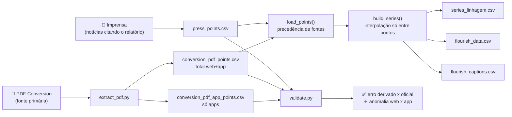

# 🛒 A corrida dos marketplaces no Brasil (2024–2025)

**Pipeline de dados que transforma relatórios públicos de tráfego em um _bar chart race_ auditável**, com rastreabilidade de cada número, validação contra a fonte primária e detecção automática de anomalias de medição.

<p align="center">
  
</p>

🔗 **[Ver o gráfico interativo no Flourish](https://public.flourish.studio/visualisation/30587441/)**

---

## 📌 O que os dados mostram

| | |
|---|---|
| 🥇 **Mercado Livre** | Líder em quase todo o período; fecha dez/25 com **416 mi** de acessos/mês. |
| 🚀 **Temu** | Chega em jun/24 com 9,8 mi. Em **jul/25 assume o 1º lugar (409,7 mi)**, a primeira vez que o Mercado Livre perde o topo na série. |
| 📉 **Temu (de novo)** | Cai para 147,7 mi em set/25 e para **~30 mi em nov–dez/25**. |
| 🔍 **Achado da validação** | Em nov/25 o tráfego total da Temu ficou **idêntico** ao tráfego só de app: a parcela web foi de 81% para **0%** em um mês. Isso indica provável **artefato de medição**, e não 100% de perda real de clientes web (ver [Qualidade dos dados](#-qualidade-dos-dados)). |

> Métrica: **acessos mensais** (web + app Android), não vendas. Fonte: Relatório Setores do E-commerce no Brasil (Conversion, com dados Similarweb).

---

## 🏗️ Arquitetura



| Etapa | Arquivo | O que faz |
|---|---|---|
| Extração | `extract_pdf.py` | Lê as tabelas do PDF com `pdfplumber`, classifica cada página como **total** ou **app** e falha alto se a mesma marca tiver valores divergentes. |
| Integração | `pipeline.load_points` | Junta imprensa + PDF. Em conflito no mesmo mês, **a fonte primária vence**. |
| Série | `pipeline.build_series` | Grade marca × mês; interpola **apenas entre** pontos conhecidos (sem extrapolar). |
| Exportação | `pipeline.to_flourish_*` | Gera dados (formato largo), legendas e cores prontos para o Flourish. |
| Qualidade | `validate.py` | Mede o erro dos valores derivados e detecta colapsos suspeitos de tráfego web. |

---

## ✅ Qualidade dos dados

**1. Linhagem por valor.** Cada número da série carrega `tipo` e `fonte` (`data/processed/series_linhagem.csv`):

| Tipo | Qtd. | Significado |
|---|---:|---|
| `oficial` | 73 | Publicado pela Conversion (PDF ou imprensa citando o relatório) |
| `derivado` | 6 | Calculado a partir de share ou variação publicada (ex.: 276 mi ÷ 9,9% × 12,3%) |
| `interpolado` | 61 | Linear entre dois meses conhecidos |

**2. Validação do método de derivação.** Os valores de jun/25 foram *derivados* antes de termos o PDF. Depois, comparados com o oficial:

| Marca | Derivado | Oficial | Erro |
|---|---:|---:|---:|
| Shopee | 258,2 | 259,5 | 0,50% |
| Mercado Livre | 357,1 | 358,5 | 0,39% |
| Temu | 241,7 | 241,9 | 0,08% |
| Amazon | 175,8 | 175,9 | 0,06% |

**Erro médio de 0,26%**, o que confirma que a derivação por share é confiável para preencher lacunas.

**3. Detecção de anomalia web × app.** Como o PDF traz o tráfego total e o tráfego só de app, o pipeline calcula `web = total − app`. Se a parcela web cai de >20% para <1% de um mês para o outro, o ponto é sinalizado:

```
marketplace     mes  acessos_mi_total  acessos_mi_app  share_web_mes_anterior  share_web
       Temu 2025-11              30.6            30.6                   0.813        0.0
```

O dado **não é apagado** (é o que a fonte publicou), mas é **sinalizado**. Uma queda real de clientes reduziria web e app; aqui o app ficou estável (27,8 → 30,6 mi) e só o web sumiu.

---

## 🚀 Como rodar

```bash
git clone https://github.com/patrese-procopio/marketplaces-br-race.git
cd marketplaces-br-race
python -m venv .venv && .venv\Scripts\activate      # Windows
pip install -e ".[dev]"

# 1. (opcional) extrair um novo PDF da Conversion
python -m marketplace_race.extract_pdf caminho/relatorio.pdf --label "dez/25"

# 2. gerar a série e os arquivos do Flourish
python -m marketplace_race.pipeline

# 3. controles de qualidade
python -m marketplace_race.validate

# 4. testes
pytest
```

Os arquivos do Flourish ficam em `data/processed/`: suba `flourish_data.csv` na aba **Data**, `flourish_captions.csv` na aba **Captions** e cole `flourish_colors.txt` em **Colors → Custom overrides**.

---

## 📁 Estrutura

```
marketplaces-br-race/
├── src/marketplace_race/
│   ├── config.py        # período, marcas, cores, aliases do PDF
│   ├── extract_pdf.py   # PDF -> pontos (total e app)
│   ├── pipeline.py      # precedência, interpolação, exportação
│   └── validate.py      # derivado x oficial, anomalia web x app
├── data/
│   ├── raw/             # pontos coletados (imprensa + PDF extraído)
│   └── processed/       # série com linhagem + arquivos do Flourish
├── tests/               # 15 testes das regras críticas
└── assets/              # prévias do gráfico
```

---

## 🧠 Decisões técnicas

- **Dados fora do código.** Os pontos coletados vivem em CSV (`data/raw`), não em listas Python. Para atualizar, basta adicionar linhas, sem mexer em lógica.
- **Formato longo para armazenar, largo para apresentar.** Uma linha por observação (com `fonte`) permite linhagem; o `pivot` só acontece na exportação.
- **`interpolate(limit_area="inside")`.** Sem esse parâmetro, o pandas repetiria o último valor até o fim da série e inventaria dados.
- **Hierarquia de fontes explícita (`SOURCE_PRIORITY`).** É o mesmo princípio de avaliação de confiabilidade de fontes usado em análise de inteligência: a fonte primária prevalece sobre a secundária.
- **Aliases rigorosos.** No PDF, "Amazon" sozinho é a amazon.com (seção Importados) e "Mercado libre" é o site argentino. Só `Amazon Brasil` e `Mercado Livre` entram, e há teste cobrindo isso.
- **Falhar alto.** Marca desconhecida ou valor divergente entre tabelas interrompe o pipeline em vez de gerar um gráfico errado em silêncio.

---

## ⚠️ Limitações

- **Acessos ≠ vendas.** Mais tráfego não significa mais faturamento.
- **iOS não incluso** na fonte (só web + app Android).
- **61 valores interpolados**, concentrados em 2024 e início de 2025. Relatórios mensais adicionais da Conversion podem substituí-los por valores oficiais.
- **Temu nov–dez/25:** provável artefato de medição no tráfego web (ver validação).

## 🔐 LGPD e uso de dados

O projeto usa apenas **dados agregados de empresas** (acessos mensais por site), sem nenhum dado pessoal. O PDF da Conversion **não é redistribuído** (`.gitignore`); apenas os números extraídos, com citação da fonte.

---

**Autor:** Patrese Arruda · Engenharia de Dados & IA · [GitHub](https://github.com/patrese-procopio)
